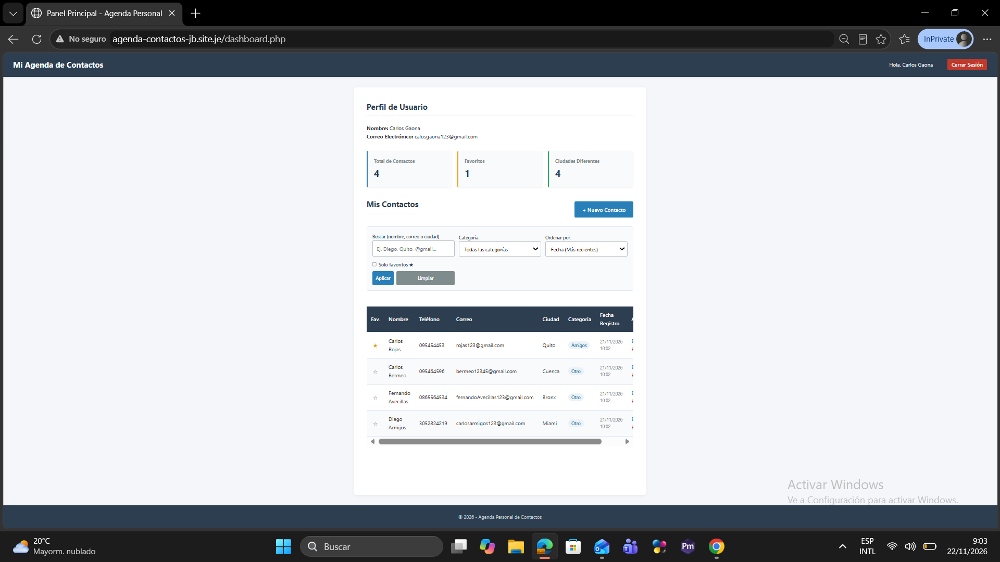
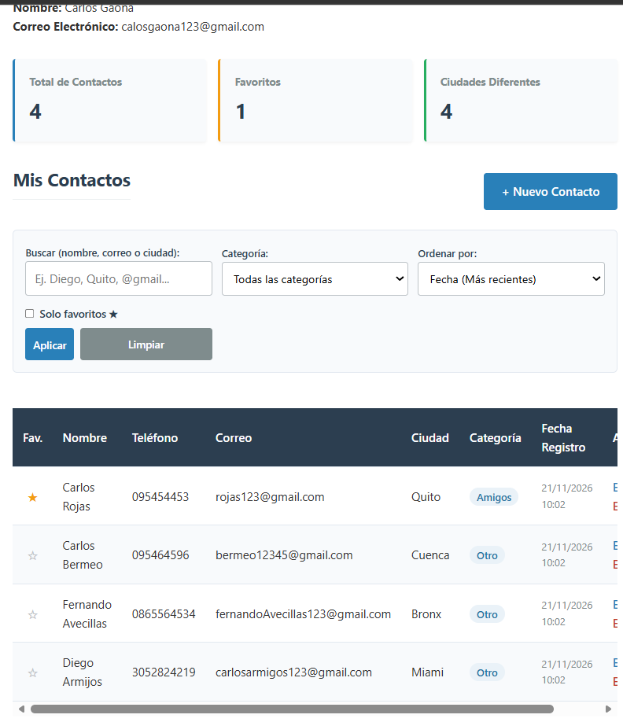

# Agenda Personal de Contactos (PHP y MySQL)

Aplicación web desarrollada en **PHP (PDO)** y **MySQL** para la gestión personal de contactos con autenticación de usuarios, aislamiento de datos por sesión, categorías, favoritos, búsqueda y ordenamiento, desplegada en un hosting gratuito.

---

## 1. URL Pública

* **Sistema en línea:** http://agenda-contactos-jb.site.je
* **Panel principal:** http://agenda-contactos-jb.site.je/dashboard.php

---

## 2. Capturas de Pantalla

### Panel Principal y Contactos

### Gestión y Listado de Contactos

---

## 3. Tecnologías Utilizadas

* **Backend:** PHP con PDO (consultas preparadas, `password_hash()`, `password_verify()` y control de sesiones con `session_start()`)
* **Base de Datos:** MySQL / MariaDB (`utf8mb4_general_ci`)
* **Frontend:** HTML5 y CSS3 (`estilos.css`)
* **Entorno Local:** XAMPP (Apache, MySQL y phpMyAdmin)
* **Hosting Gratuito:** InfinityFree
* **Control de Versiones:** Git y GitHub

---

## 4. Instrucciones para Instalar el Proyecto Localmente

1. **Obtener el código del repositorio:**
   Clona el repositorio o descarga el ZIP y colócalo dentro de la carpeta `htdocs` de XAMPP (por ejemplo, `C:\xampp\htdocs\agenda_contactos`):
   `git clone https://github.com/Jonathadx/agenda_contactos.git`

2. **Iniciar Apache y MySQL en XAMPP:**
   * Abre **XAMPP Control Panel** e inicia los servicios **Apache** y **MySQL**.

3. **Importar la base de datos:**
   * Entra a `http://localhost/phpmyadmin`.
   * Crea la base de datos `agenda_db` con cotejamiento `utf8mb4_general_ci`.
   * Abre la pestaña **Importar**, selecciona el archivo `agenda_db.sql` del repositorio y haz clic en **Importar / Continuar**.

4. **Configurar la conexión local:**
   * Revisa el archivo `conexion.php` para que utilice tus credenciales locales de XAMPP (`localhost`, base `agenda_db`, usuario `root` y contraseña vacía por defecto).

5. **Abrir el proyecto en el navegador:**
   * Accede a `http://localhost/agenda_contactos` e inicia sesión o registra un usuario.

---

## 5. Detalle de las Mejoras Respecto a la Versión Anterior

* **Búsqueda de contactos:** Permite filtrar contactos por **nombre**, **correo** y **ciudad**.
* **Ordenamiento:** Permite ordenar el listado de contactos por **nombre**, **ciudad** o **fecha de creación**.
* **Categorías:** Se incorporó la tabla `categorias` con las opciones **Familia**, **Amigos**, **Trabajo**, **Universidad** y **Otro**, asociando cada contacto a una categoría.
* **Contactos favoritos:** Se añadió el campo de **Favorito** (`Sí` / `No`) junto con la opción para visualizar únicamente los contactos favoritos y los indicadores del panel.
